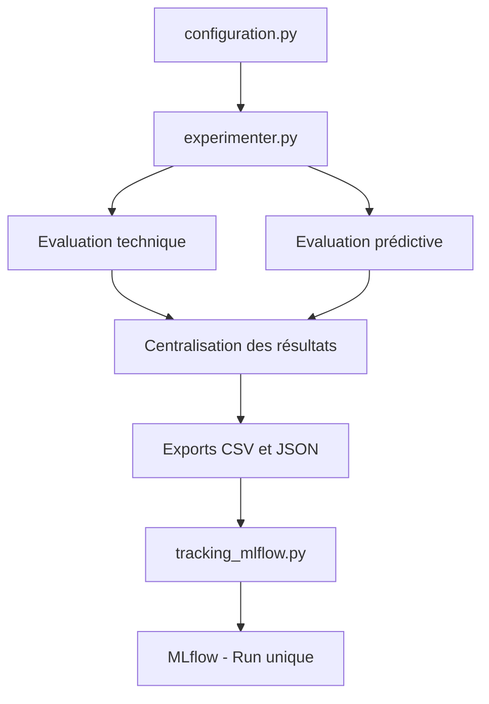

# MLOps et suivi des expérimentations avec MLflow

Le processus d'évaluation permet de générer et de conserver localement les résultats prédictifs et techniques de chaque expérimentation.

Afin de faciliter leur suivi et leur comparaison, MLflow a été intégré au projet. L'objectif est de centraliser les résultats, d'identifier les configurations utilisées et de suivre les différentes versions du modèle au cours des prochaines optimisations.

## 1. Installation et configuration

MLflow a été installé dans l'environnement Conda `vision-api` :

```powershell
pip install mlflow
```

Démarrage du serveur depuis la racine du projet :

```powershell
mlflow server --host 127.0.0.1 --port 5000 --backend-store-uri sqlite:///mlflow_tracking/mlflow.db --artifacts-destination ./mlflow_tracking/artifacts
```

Interface accessible à l'adresse : [http://127.0.0.1:5000](http://127.0.0.1:5000).

Les informations sont stockées dans le dossier suivant :

```text
mlflow_tracking/
├── mlflow.db
└── artifacts/
```

## 2. Mise en place du suivi des expérimentations

Afin d'assurer un suivi systématique des évaluations, un module dédié au tracking MLflow a été créé : `evaluation/tracking_mlflow.py`.

Ce module est appelé automatiquement par l'orchestrateur `experimenter.py`, après l'exécution des évaluations et l'export des résultats.

Chaque expérimentation est enregistrée dans l'expérience `Evaluation predictive` sous la forme d'un Run unique, pouvant regrouper les résultats prédictifs, techniques ou les deux.

| Élément MLflow | Contenu |
|---|---|
| Parameters | Configuration du modèle, dataset, prétraitement, matériel, précision numérique et protocole de mesure |
| Metrics — Prédictives | Accuracy Top-1, Top-5, précision, rappel et F1-score |
| Metrics — Techniques | Taille du modèle, latence, percentiles, débit et performances par taille de lot |
| Artifacts | Fichiers CSV et JSON générés lors des évaluations |
| Tags | Identifiant de l'expérimentation, date et type d'évaluation |

### Intégration dans le processus d'évaluation

Le tracking est activé depuis le fichier `configuration.py` :

```python
MLFLOW_ACTIF = True
```

L'appel au module de tracking est intégré au script `experimenter.py` :

```python
if cfg.MLFLOW_ACTIF:
    from tracking_mlflow import enregistrer_evaluation

    enregistrer_evaluation(dossier_run)
```



Trois types d'expérimentations sont identifiés dans MLflow à l'aide du tag `type_experimentation` :

| Type | Contenu |
|---|---|
| `predictive` | Évaluation prédictive uniquement |
| `technique` | Évaluation technique uniquement |
| `complete` | Évaluations prédictive et technique |

Cette organisation permet de comparer simultanément la qualité prédictive et les performances techniques des différentes configurations du modèle.


## 3. Comparaison des expérimentations

L'interface MLflow permet de consulter l'ensemble des expérimentations, de personnaliser les colonnes affichées et de sélectionner plusieurs Runs afin de comparer leurs résultats.

Les principaux indicateurs de comparaison sont les suivants :

| Catégorie | Indicateurs |
|---|---|
| Configuration | Version du modèle, moteur d'inférence, prétraitement, précision numérique, matériel |
| Qualité prédictive | Accuracy Top-1, Accuracy Top-5, F1-score macro |
| Latence | Moyenne, P50, P95 et P99 |
| Débit | Nombre d'images par seconde selon la taille du lot |
| Taille | Taille du fichier du modèle |


L'objectif est de faciliter la recherche d'un compromis entre qualité prédictive, performances techniques et ressources nécessaires à l'exécution du modèle.

## 4. Dataset Tracking

Afin d'améliorer la traçabilité des données utilisées, le Dataset Tracking de MLflow a été intégré au module `tracking_mlflow.py`.

Le fichier `labels.csv` est chargé sous forme de DataFrame Pandas, puis enregistré comme dataset MLflow.

```python
labels = pd.read_csv(fichier_labels)

dataset = mlflow.data.from_pandas(
    labels,
    source=str(fichier_labels),
    name=nom_dataset,
    targets="label"
)

mlflow.log_input(dataset, context="evaluation")
```

Le dataset est directement associé aux Runs comportant une évaluation prédictive.

| Élément | Valeur |
|---|---|
| Dataset | `benchmark_v1` |
| Source | `labels.csv` |
| Target | `label` |
| Contexte | `evaluation` |
| Digest MLflow | `a63fcc4c` |

Cette identification permet de retrouver le dataset utilisé lors d'une expérimentation et de faciliter la comparaison des évaluations réalisées sur les mêmes données.


## 5. Enregistrement et versionnement des modèles

Le Model Registry de MLflow permet de centraliser les différentes versions du modèle utilisées au cours du projet.

Le modèle initial ConvNeXt-Tiny, au format PyTorch FP32, a été enregistré à l'aide du script `exploration/test_mlflow_model.py`.

```python
with mlflow.start_run(
    run_name="Enregistrement ConvNeXt-Tiny FP32"
):
    model_info = mlflow.pytorch.log_model(
        pytorch_model=model,
        name="convnext_tiny_pytorch_fp32",
        input_example=torch.zeros(1, 3, 224, 224).numpy(),
        registered_model_name="xray_bodypart_classifier"
    )
```

### Modèle enregistré

| Élément | Valeur |
|---|---|
| Logged Model | `convnext_tiny_pytorch_fp32` |
| Model Registry | `xray_bodypart_classifier` |
| Version | 1 |
| Architecture | ConvNeXt-Tiny |
| Framework | PyTorch |
| Précision | FP32 |
| Model ID | `m-602a55cecd5945cc9d6866d62ec649c0` |

Le modèle enregistré correspond au réseau neuronal seul. Il reçoit un tenseur déjà prétraité et n'intègre pas l'ensemble de la chaîne de traitement des radiographies.

Les expérimentations utilisant les mêmes poids sont associées au même modèle, sans duplication de celui-ci.

Les futures versions ONNX et quantifiées pourront être enregistrées dans ce même registre.

### Association du modèle aux évaluations

Les modèles enregistrés dans MLflow sont référencés dans le module `tracking_mlflow.py`.

```python
MODELES_MLFLOW = {
    "pytorch_fp32": {
        "model_id": "m-602a55cecd5945cc9d6866d62ec649c0",
        "registry": "xray_bodypart_classifier",
        "version": 1
    }
}
```

Ce dictionnaire sera enrichi lors de l'intégration des prochaines versions du modèle.

Les métriques prédictives sont associées au modèle et au dataset utilisés :

```python
mlflow.log_metrics(
    metriques_predictives,
    model_id=model_id,
    dataset=dataset
)
```

Les métriques techniques sont associées uniquement au modèle :

```python
mlflow.log_metrics(
    metriques_techniques,
    model_id=model_id
)
```

Le modèle est également déclaré comme entrée du Run :

```python
from mlflow.entities import LoggedModelInput

mlflow.MlflowClient().log_inputs(
    run_id=run.info.run_id,
    models=[
        LoggedModelInput(model_id=model_id)
    ]
)
```

Les paramètres `modele_registry` et `modele_registry_version` permettent également d'identifier explicitement la version évaluée dans le tableau des expérimentations.

Cette organisation permet de distinguer les différentes configurations d'évaluation d'un même modèle des expérimentations réalisées sur de nouvelles versions de celui-ci.

## 6. Organisation des fichiers

```text
Vision par ordinateur/
├── evaluation/
│   ├── configuration.py
│   ├── experimenter.py
│   ├── evaluer_modele.py
│   ├── evaluer_performances.py
│   ├── tracking_mlflow.py
│   └── resultats/
├── exploration/
│   └── test_mlflow_model.py
└── mlflow_tracking/
    ├── mlflow.db
    └── artifacts/
```

| Fichier ou dossier | Responsabilité |
|---|---|
| `configuration.py` | Activation du tracking et configuration de l'expérimentation |
| `experimenter.py` | Orchestration des évaluations et déclenchement du tracking |
| `tracking_mlflow.py` | Enregistrement des paramètres, métriques, artefacts, datasets et associations aux modèles |
| `resultats/` | Conservation locale des résultats des expérimentations |
| `mlflow_tracking/` | Stockage des informations et artefacts gérés par MLflow |

