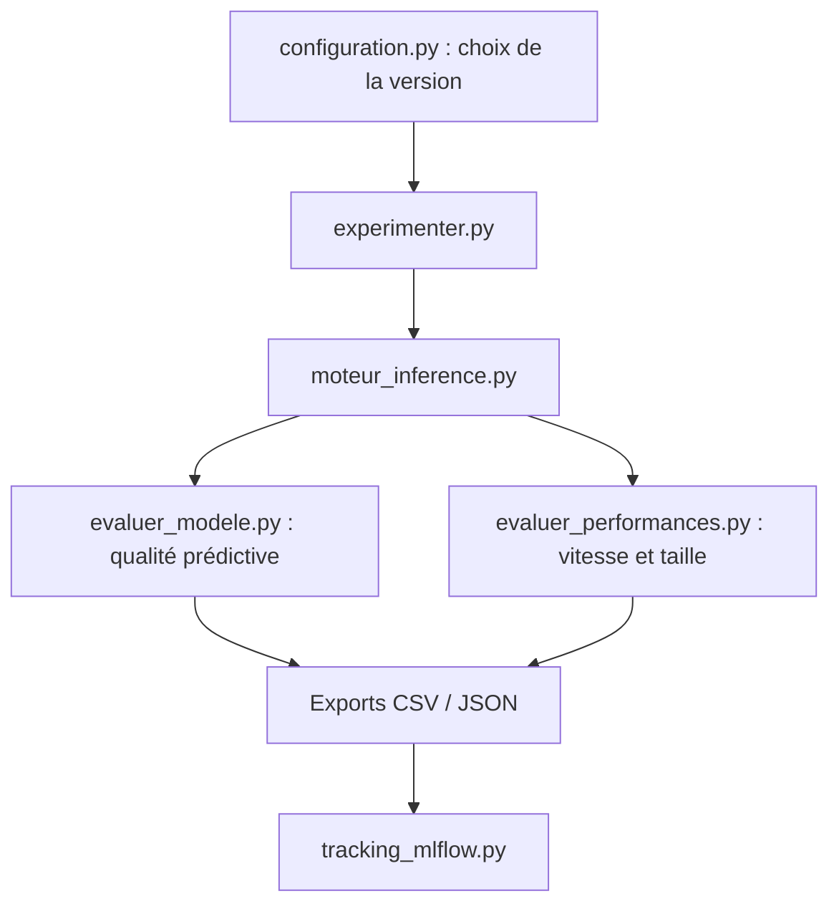

# Optimisation du modèle : exploration de PyTorch et ONNX

Jusqu'ici, le projet utilise `models/xray/best.pt`, chargé avec PyTorch. Le diagnostic précédent a permis d'établir une baseline prédictive.

La question est : **peut-on exécuter ce même modèle autrement, avec une taille ou une vitesse différente, tout en conservant ses prédictions ?**

Deux pistes ont été retenues :

- **ONNX FP32**, pour comparer l'exécution PyTorch avec ONNX Runtime sans réduire volontairement la précision des poids ;
- **ONNX FP16**, pour observer l'effet d'une représentation numérique plus compacte.

Un troisième fichier, **le modèle ONNX fourni par l'auteur**, a également été conservé afin de disposer d'un point de comparaison supplémentaire.

ONNX (Open Neural Network Exchange) est un format ouvert permettant de représenter un modèle de machine learning indépendamment du framework utilisé pour le créer. Un modèle entraîné avec PyTorch peut ainsi être exporté au format ONNX, puis exécuté avec un moteur comme ONNX Runtime, sans avoir besoin de PyTorch pour l'inférence.

L'intérêt est de pouvoir utiliser différents moteurs d'exécution, potentiellement mieux optimisés selon le matériel (CPU, GPU), tout en conservant le fonctionnement du modèle d'origine.

## Exportation du modèle vers ONNX

### Export en FP32

Un script `models/xray/export_onnx.py` a été créé pour partir du modèle PyTorch `best.pt` et produire :

```text
models/xray/convnext_tiny_fp32.onnx
```

L'export reprend le réseau ConvNeXt-Tiny, avec une entrée de forme `[batch, 3, 224, 224]`, une sortie de 33 scores et une dimension de batch dynamique. Le fichier généré est vérifié avec les outils ONNX.

```powershell
python models/xray/export_onnx.py --format fp32
```

### Conversion en FP16

Une seconde variante a été produite avec le même script :

```powershell
python models/xray/export_onnx.py --format fp16
```

Fichier obtenu :

```text
models/xray/convnext_tiny_fp16.onnx
```

Cette conversion réduit la précision numérique des poids et opérations compatibles de **32 bits à 16 bits**. Les entrées et sorties restent en FP32 : le modèle demeure utilisable avec les mêmes tenseurs d'entrée que la version ONNX FP32.

L'intérêt attendu est surtout une réduction de la taille du modèle. Le gain de vitesse, lui, n'est **pas automatique**, en particulier sur CPU.

### Version ONNX fournie par l'auteur

Le fichier d'origine a été conservé séparément :

```text
models/xray/auteur/model.onnx
```

Une différence a été identifiée à l'inspection des graphes :

- nos exports ONNX produisent des **logits**, c'est-à-dire des scores bruts ;
- le fichier ONNX de l'auteur produit déjà des **probabilités**, car son graphe contient un `Softmax` final.

Il fallait en tenir compte pour comparer correctement les quatre versions : appliquer un deuxième Softmax au modèle de l'auteur aurait faussé les scores.

## Adaptation de la chaîne d'évaluation 

Plutôt que d'écrire un benchmark différent pour chaque format, le module **`evaluation/moteur_inference.py`** a été ajouté. Sa classe `MoteurInference` fournit une interface commune :

- `executer(tensor)` : exécuter le réseau, utilisé pour mesurer la vitesse ;
- `predire(image, top_k, pretraitement)` : préparer l'image et obtenir les classes et probabilités, utilisé pour la qualité prédictive.

Le moteur choisit PyTorch ou ONNX Runtime selon la version et applique un Softmax seulement lorsque le fichier renvoie des logits.

Les scripts d'évaluation ont été mis à jour afin d'intégrer la possibilité de choisir le modèle. Ainsi que la chaine de traitement MLFlow afin de tracer les choix de modèle et leurs métriques associées. 

Le reste de la chaîne reste identique :



Le choix du modèle est devenu un **simple paramètre**, au même titre que le prétraitement :

```python
VERSION_MODELE = "onnx_fp32"  # ou pytorch_fp32, onnx_fp16, onnx_auteur
PRETRAITEMENT = "resize"

EVALUATION_PREDICTIVE = True
EVALUATION_TECHNIQUE = True
MLFLOW_ACTIF = True
```

L'exécution est la même pour chaque essai :

```powershell
python evaluation/experimenter.py
```

## Réalisation des quatre évaluations

Pour que les résultats soient comparables, les quatre exécutions ont utilisé les mêmes paramètre que ceux utilisé dans l'établissement de la baseline.

Les tests techniques utilisent **une image déjà prétraitée**. Le temps de chargement de l'image, son redimensionnement et le traitement HTTP de l'API ne font donc pas partie de la latence mesurée. Pour le batching, on répète le même tenseur pour former les lots : c'est un test du moteur, pas une simulation de plusieurs utilisateurs.

### Résultats prédictifs

| Métrique | PyTorch FP32 | ONNX FP32 | ONNX FP16 | ONNX auteur |
|---|---:|---:|---:|---:|
| Accuracy Top-1 | 57,50 % | 57,50 % | 57,50 % | 57,50 % |
| Accuracy Top-5 | 85,00 % | 85,00 % | 85,00 % | 85,00 % |
| Précision macro | 81,49 % | 81,49 % | 81,49 % | 81,49 % |
| Rappel macro | 57,50 % | 57,50 % | 57,50 % | 57,50 % |
| F1-score macro | 65,01 % | 65,01 % | 65,01 % | 65,01 % |

**Observation :** les quatre versions donnent exactement les mêmes métriques agrégées sur les 200 images. Nos changements de format et de précision n'ont donc pas dégradé ces indicateurs sur ce benchmark.


### Résultats techniques

| Métrique | PyTorch FP32 | ONNX FP32 | ONNX FP16 | ONNX auteur |
|---|---:|---:|---:|---:|
| Taille du fichier (Mo) | 111,44 | 111,46 | **55,80** | 111,46 |
| Latence moyenne (ms) | 143,42 | 53,95 | 63,29 | **44,92** |
| P95 (ms) | 252,10 | 69,59 | 69,38 | **56,04** |
| Débit batch 1 (images/s) | 11,61 | 21,27 | 15,88 | **22,64** |
| Débit batch 8 (images/s) | 6,28 | **19,71** | 13,11 | 16,07 |

Ces résultats donnent plusieurs observations concrètes :

1. **ONNX FP32** conserve la taille du fichier PyTorch et affiche une latence plus faible lors de cet essai.
2. **ONNX FP16** divise pratiquement la taille sur disque par deux, mais n'accélère pas l'inférence sur notre CPU par rapport à ONNX FP32.
3. **ONNX auteur** obtient ici la plus faible latence moyenne. Son graphe n'est toutefois pas strictement identique à nos exports puisqu'il comprend le Softmax final.
4. **Le modèle le plus petit n'est pas forcément le plus rapide.** Cela dépend du matériel et de la manière dont le moteur traite les opérations.

Il faut rester prudent : les évaluations ont été faites successivement sur un poste local, sans stabilisation complète de la charge système ni des réglages de threads. Elles servent à **comprendre les tendances**, pas à produire un classement définitif.


## Bilan de l'itération 

Sur CPU, `onnx_fp32` semble être une option intéressante pour une éventuelle optimisation future. L'export de l'auteur est également à examiner. Les temps mesurés restent exploratoires et devraient être confirmés avant de choisir un modèle pour une application réelle.